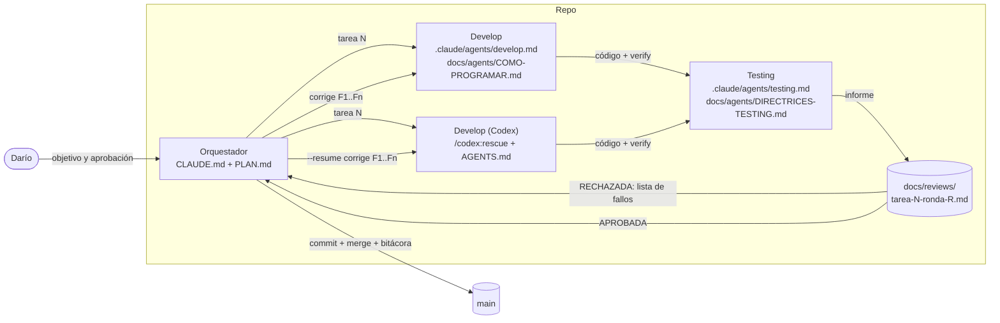
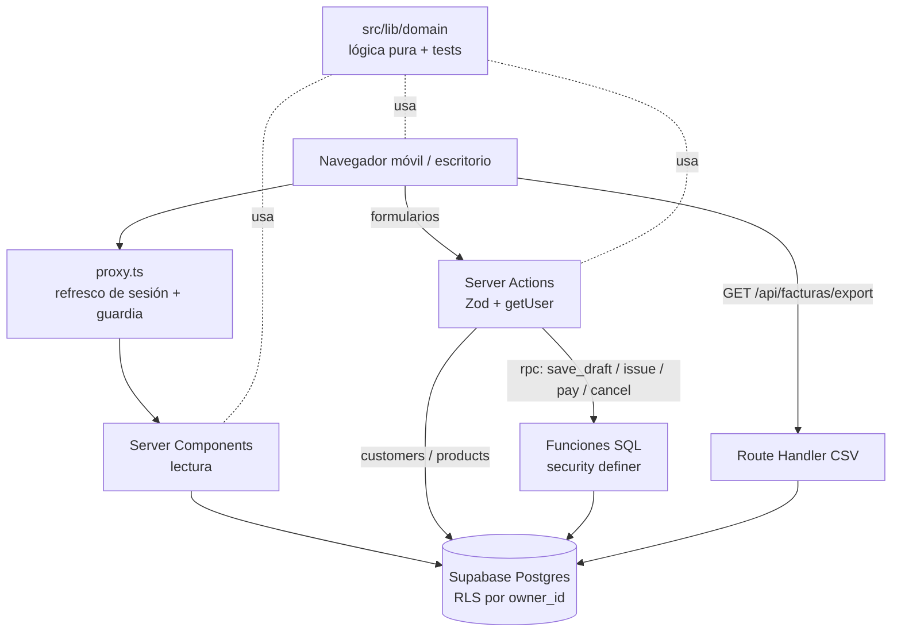
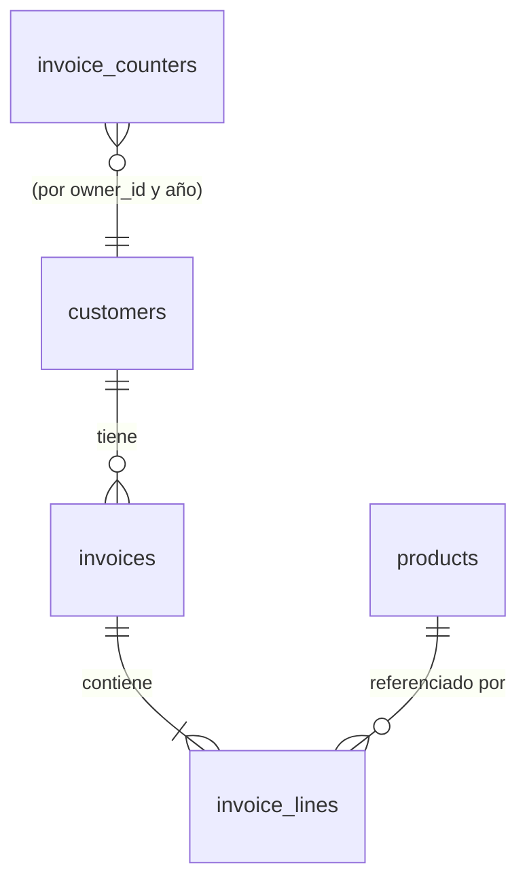

# Arquitectura

Hay dos arquitecturas que conviene separar: la del **equipo de agentes** que construye
la app y la de **la app** en sí.

## 1. Equipo de agentes

| Pieza | Responsabilidad | Qué NO hace |
|---|---|---|
| **Orquestador** (`CLAUDE.md`) | Diseña, escribe `PLAN.md`, reparte tareas, gestiona las rondas, hace commit y merge y documenta | No escribe el grueso del código ni aprueba sin Testing |
| **Develop** (`develop.md`) | Implementa una tarea siguiendo `COMO-PROGRAMAR.md` y las directrices | No hace commit, no cambia decisiones ni se revisa a sí mismo |
| **Develop-Codex** | Lo mismo que Develop, con otro modelo (GPT vía el plugin de Codex) | Igual. Además no ve la conversación: solo `PLAN.md` y `AGENTS.md` |
| **Testing** (`testing.md`) | Es dueño de las directrices, revisa el diff, ejecuta la puerta de calidad, busca casos límite y emite el veredicto | No modifica código: solo escribe informes |

**Por qué así:**
- **Separar quién escribe y quién revisa.** El que escribe tiende a validar su propio
  trabajo; Testing tiene un listón escrito y fijo y no puede "arreglar en silencio".
- **Directrices con ID** (`SEG-3`, `DOM-2`…). Los informes son accionables y medibles, y
  la bitácora muestra qué tipo de fallo aparece más.
- **Dos modelos para Develop.** Claude y Codex se alternan según el tipo de tarea, y la
  revisión cruzada encuentra fallos que un solo modelo no ve.
- **Todo por escrito.** Codex no ve la conversación, así que obliga a que el plan sea
  autocontenido, y eso beneficia también a cualquier humano que herede el proyecto.
- **Un límite de 4 rondas** evita bucles infinitos y escala el problema al humano.

## 2. La aplicación

### Decisiones clave
1. **Seguridad en la base de datos, no en la app.** La anon key es pública por diseño.
   RLS garantiza que cada usuario solo ve lo suyo, aunque alguien llame directamente a
   la API REST de Supabase.
2. **Las facturas solo se escriben mediante funciones SQL atómicas.** Emitir una factura
   implica validar el estado, comprobar el stock de cada línea, descontarlo y asignar un
   número correlativo, todo en una transacción y con bloqueos de fila (`for update`).
   Revocar el insert/update directo impide que un cliente malicioso se salte esas reglas.
3. **Lógica de dominio pura y duplicada a propósito.** El cálculo de IVA existe en TS (para
   la vista previa instantánea en el editor) y en SQL (como fuente de verdad). Testing
   comprueba que ambos siguen la misma fórmula (DOM-2).
4. **Dinero en céntimos enteros.** Así se evitan los errores de coma flotante (0,1 + 0,2).
5. **Server Components y Server Actions.** Sin capa de API propia ni estado global en el
   cliente: menos código y menos superficie de ataque.

### Modelo de datos
Ver `PLAN.md` § "Esquema de datos" y `supabase/migrations/`.

